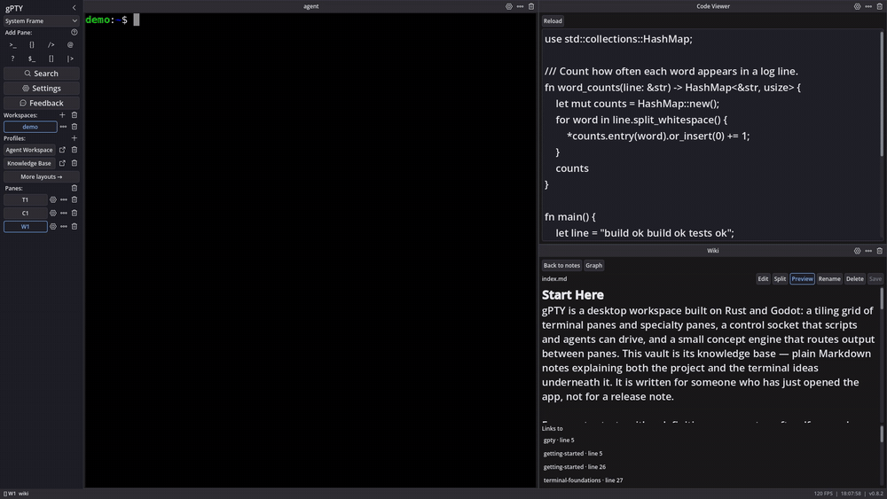
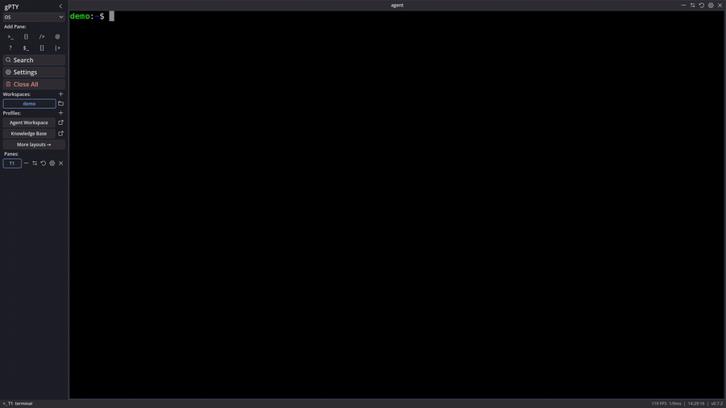
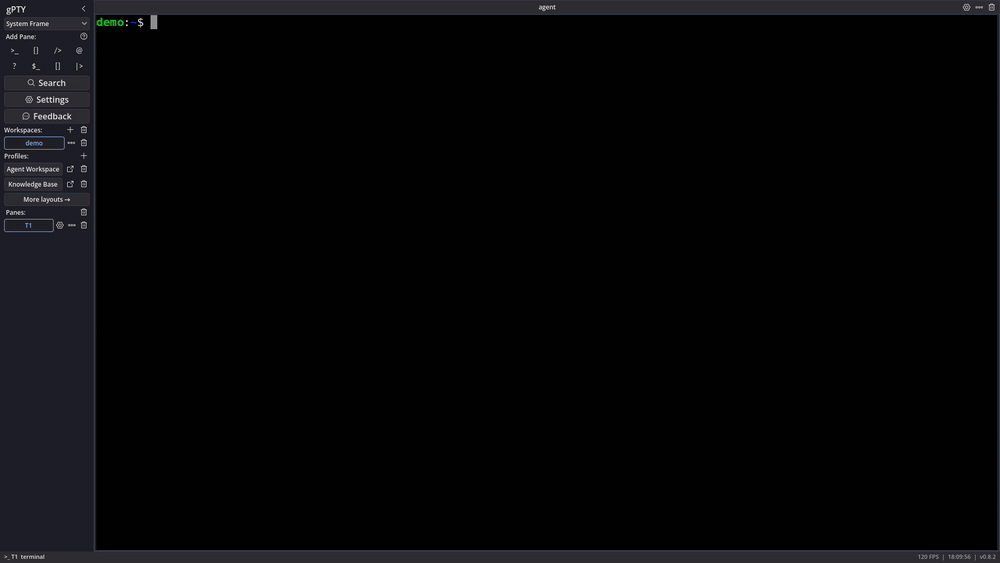
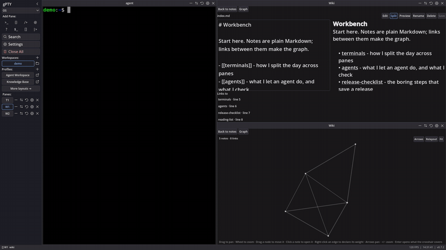
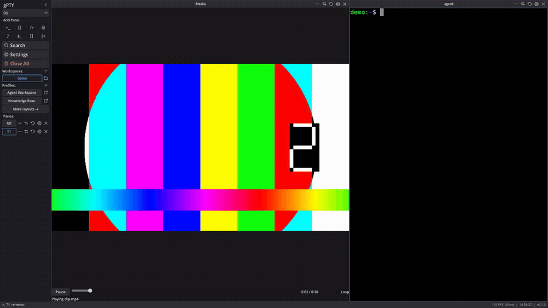
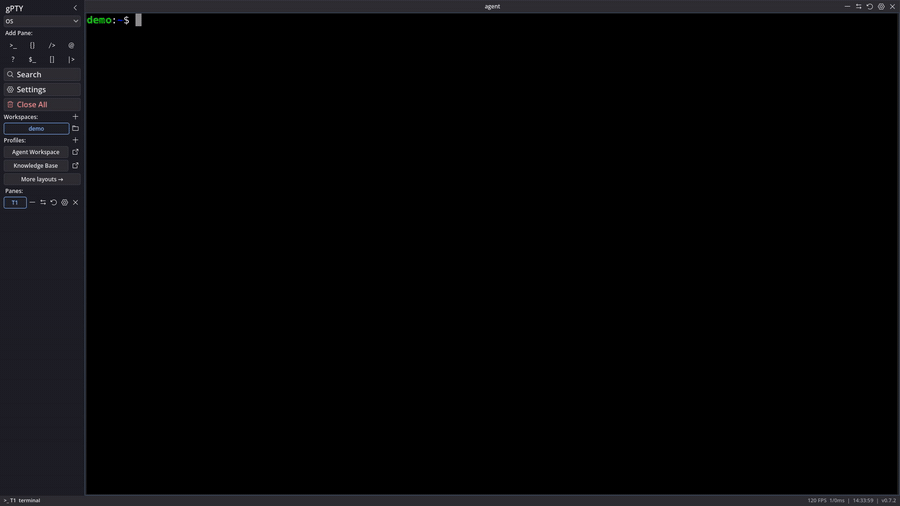
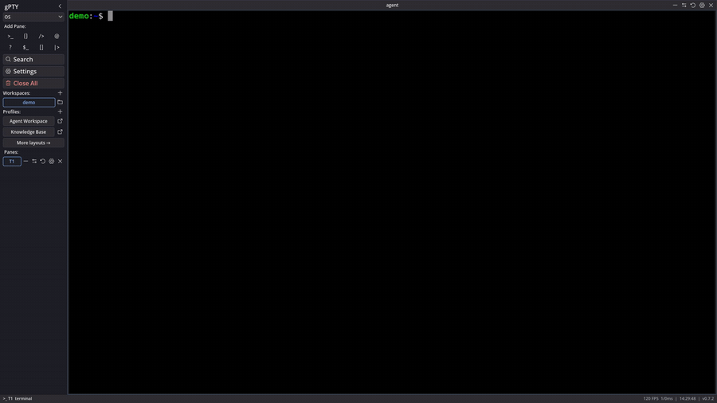
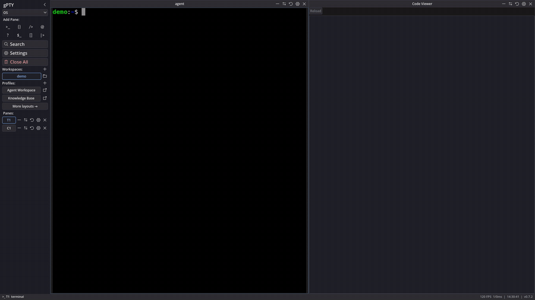

<div align="center">

  [](https://github.com/godot-pty/gpty/actions/workflows/ci.yml) [](https://insights.linuxfoundation.org/project/godot-pty-gpty) [](https://www.bestpractices.dev/projects/16201)

   [](https://securityscorecards.dev/viewer/?uri=github.com/godot-pty/gpty) [](https://github.com/godot-pty/gpty#verifying-releases)

  [](https://github.com/godot-pty/gpty/releases/latest) 

</div>

[gPTY](https://gpty.dev/) - a desktop workspace built on Rust and Godot. It provides a tiling grid for panes (terminals, code viewers, file trees, wikis, media, and more), a concept capture engine, and a JSON-RPC/MCP control surface so AI agents and automation tools can spawn panes, inject text, and observe output on terminals without scraping a TUI. Every pane can be driven from a shell, a script, or an agent over one public API.

It is a side project in active development and a vast majority of this codebase, including most of the Godot UI layout and the Rust (`gpty-core`) GDExtension bridge, was generated using various LLMs under human review; and as such, the underlying code may contain unidiomatic patterns and/or bugs. It *does not* follow the core UNIX philosophy very well, as in, it does aim to do several things; though it does also intend to do them all well.

The chosen stack also brings with it more costs, much more than terminal emulators. A TUI can just draw into cells the terminal already owns, while gPTY runs a Godot renderer - an idle window can hold around 650 MB of resident memory, all of it owned by the renderer (multiple panes/terminals themselves are cheap in the GUI's own memory ([RSS](https://en.wikipedia.org/wiki/Resident_set_size)), under 1 MB each, but each one runs a shell in its own process at about 6 MB, up to the 96-pane ceiling). A first Forward+ launch (the implicit default, since `project.godot` names no renderer) holds about 1 GB because the graphics driver compiles its pipelines into that process; about 430 MB of it stays resident for the run, and later launches drop the number back to ~650 MB. Another drawback of a game engine is that it draws a frame every frame whether or not anything changed, whereas a terminal emulator composites only when its cells change (output, a blinking cursor, a resize). A GPU window that repaints even while idle draws power that a standard PTY simply would not. Memory usage and power draw remain areas that the project aims to continually refine and reduce, rather than have them be fixed prices to pay. Refer to the [Trade-offs](#trade-offs) section for up-to-date statistics.



### Features

**Panes**

<details>
<summary>Watch: the pane grid split and reflow</summary>



</details>

- **Tiling grid** - split, resize, and rearrange independent shell sessions; save and reload named layouts, workspaces (tab sets), and profiles.
- **Emulation** - `alacritty_terminal` grid with `16`/`256`/`true color`, scrollback with regex search, and wrapped text selection.
- **Memory** - scrollback, settings, and workspaces restore on restart, with full-text search across each pane's history.
- **File Tree** - Native Godot OS file tree browser.
- **Code Viewer** - Text and Markdown rendered in a pane.
- **Wiki** - a vault of plain Markdown notes with full-text search, a live-preview editor, `[[wikilinks]]`, backlinks, and a link graph, reopened where you left off. The shipped **Knowledge Base** profile opens the bundled wiki inside a release.
- **Media** - play local audio and video in a pane through a pinned, minimal FFmpeg backend (v0.7).
- **`cli_view`** - stream any command's output into a pane, so a plugin can add UI without a Godot SDK.
- **Interface** - one design system across every pane, overlay and dialog: a dark theme and a light theme that follows the desktop, a UI scale, keyboard rings on the pane chrome, the Wiki pane and the vault graph, a command palette with saved commands, and accessible names for screen readers (v0.8).

<details>
<summary>Watch: the two profiles the app ships open from the sidebar</summary>



</details>

<details>
<summary>Watch: the wiki vault, its link graph and a CLI search</summary>



</details>

<details>
<summary>Watch: audio and video in a pane</summary>



</details>

<details>
<summary>Watch: a command streamed into its own pane</summary>



</details>

**Agents & Automation**

<details>
<summary>Watch: tagged panes, one broadcast and agent state badges</summary>



</details>

<details>
<summary>Watch: a concept routing output into the adjacent pane</summary>



</details>

- **One API, three doors** - the same operations are available as a JSON-RPC socket, the `gpty` CLI, and an MCP server: spawn panes, inject input, read output, run a command and wait for a pattern, broadcast to tagged panes. The server is listed in the [official MCP registry](https://registry.modelcontextprotocol.io/?search=gpty) as `io.github.godot-pty/gpty`.
- **Agent state badges** - an agent declares `working` or `needs attention` from its own pane and the tab shows it. Display only.
- **Observability panes** - Reasoning passively shows documented agent lifecycle events (OMP today, adapter-neutral vocabulary); Inspector is a private, tool-free Q&A session. gPTY never orchestrates agent state.
- **Concepts** - regex triggers on terminal output capture the reply and route it into an adjacent pane. Write your own in Settings, by hand or in the visual graph editor. Concepts display only; they never type into a shell.

**Limited Extensibility**

- **Plugins** - manifest-based, reviewed in the GUI before install, with a public [registry](https://gpty.dev/plugins/).

### Status

- Documentation & Blogs: https://gpty.dev
- Releases ship `SHA256SUMS` and build-provenance attestations; the control socket is owner-only.
- The repository tracks OpenSSF recommendations; registered as [OpenSSF Project 16201](https://www.bestpractices.dev/projects/16201), scorecard: [securityscorecards.dev](https://securityscorecards.dev/viewer/?uri=github.com/godot-pty/gpty).
- Release assets carry [SLSA Build Level 2](https://slsa.dev/spec/v1.0/levels) provenance.
- The project has been added to the [Linux Foundation](https://insights.linuxfoundation.org/project/godot-pty-gpty) & health will be tracked via LFX Insights.

| Component | Choice | Rationale |
|----------|--------|-----------|
| PTY library | `portable-pty` | Cross-platform (Linux `/dev/ptmx` + Windows ConPTY) with a single API |
| ANSI parsing | `vte` crate | Fast Rust ANSI state machine |
| Async runtime | `tokio` | Per-terminal tasks; channel-driven capture state machine |
| I/O threading | Dedicated `std::thread` per PTY | Predictable blocking reads; bridges to tokio via `mpsc` |
| Concept capture | Rust `regex` over parsed `LineParser` output | Linear-time matching (ReDoS-safe); captures buffer raw bytes for grid-faithful replay |
| Grid rendering | `alacritty_terminal` | Full DEC STD 070 grid state machine; pass arrays to Godot `_draw()` |
| Godot bridge | `gdext 0.5` | Native GDExtension for Godot 4.7+ |
| Rust edition | 2024 | Requires Rust >= 1.85 |

### Trade-offs

Hosting a terminal inside a game engine is expensive, in terms of RAM & power usage. The following are measured on the shipped v0.8.1 Linux build (captured on CachyOS with Godot 4.7.2, Vulkan 1.4, `VmRSS` from `/proc` in a private sandbox):

| Configuration | Resident Memory |
|---|---|
| One pane, idle (Forward+, the default) | 647 MB |
| Zero panes, renderer still up | 655 MB - the cost is the renderer, not the terminals |
| First launch, cold pipeline cache | 1076 MB, back to ~650 MB on every later run |
| Same build, `--rendering-driver opengl3`, warm | 290 MB |
| 30,000 lines through one pane, past the 10,000-row scrollback cap | +39 MB, then flat |

The above is Electron-level memory for what a TUI does inside a terminal window, and power follows from it: the window is GPU-composited and repaints while idle, so an idle gPTY is not "free" the way an idle shell (basically) is. Both of these issues are acknowledged, and are treated as debts with a plan, rather than leaving them as a permanent tax.

- **The renderer is the lever.** Compatibility (OpenGL3) is 2.2x lighter than Forward+ on the same build; the per-platform choice is an open item in the [v0.8 roadmap](docs/content/docs/roadmap/v0.8.md), and will be decided by running both through `scripts/ui-capture` (both themes, the visual-effect shaders, an 8-pane layout) rather than by preference.
- **Repaint is already bounded.** The `max_fps` setting and the terminal flood back-off limit how often a pane redraws; what is missing is an idle-frame measurement to hold it to.
- **Cost becomes a number in v0.9.** The [v0.9.0 instrumentation release](docs/content/docs/roadmap/v0.9.md) adds an in-app frame-time, CPU, memory and power readout (read from the OS, "unavailable" where the OS exposes nothing) and a gated performance budget, so later reductions are measured instead of claimed.

---

## Installation & Usage

Standalone binaries (no Godot install required) are published on [GitHub Releases](https://github.com/godot-pty/gpty/releases) for Linux, macOS, and Windows.

| Platform | Package |
|---|---|
| Linux | `gpty-v<version>-linux-x86_64.tar.gz` - extract; `./gpty-gui.sh` starts the GUI, `./gpty` is the CLI |
| macOS | `gpty-v<version>-macos.zip` - unzip, right-click the `.app` → Open; `gpty` beside it is the CLI |
| Windows | `gpty-v<version>-windows-x86_64.zip` - unzip; `gpty-gui.exe` starts the GUI, `gpty.exe` is the CLI |

Every release also bundles the gPTY knowledge base; the **Knowledge Base** profile in the sidebar opens the bundled wiki from your user data.

In the file names, `<version>` is the release tag you downloaded (for example `v0.7.0`).

### Verifying releases

Each release publishes a `SHA256SUMS` listing every asset. Check the file you downloaded before running it:

```bash
sha256sum -c SHA256SUMS            # Linux
shasum -a 256 -c SHA256SUMS        # macOS
certutil -hashfile <asset> SHA256  # Windows
```

Checksums catch a corrupted or tampered download in transit. Each asset also carries a build-provenance attestation binding it to the workflow run that built it:

```bash
gh attestation verify <asset> --repo godot-pty/gpty
```

The binaries are not code-signed (see [SECURITY.md](SECURITY.md)).

### CLI

The `gpty` binary controls a running GUI over JSON-RPC IPC, and every release bundle ships it next to the GUI. It is also on crates.io - `cargo install gpty` puts the same binary on `PATH` (a Rust toolchain and a C compiler are required, for its bundled SQLite), and that copy is what an MCP client launches for `gpty mcp`. The CLI starts one on demand only for commands a fresh workspace can satisfy - `new-pane` and `layout load` - while `gpty daemon start` starts one explicitly and `--no-daemon` never starts one. Every other command needs a workspace that already exists, so it fails with `no gpty GUI is running (start one with \`gpty daemon start\`)` instead of opening a window it cannot use. Building from source (`cargo build -p gpty`, or `cargo build --workspace`) is only needed when working on the CLI itself; if you install it that way, **reinstall it after a version bump** (`cargo install --path crates/gpty-cli --force`). A stale `gpty` earlier on `PATH` shadows the release's CLI and fails opaquely (a subcommand it lacks dies in clap before any IPC), which is why the CLI warns once, on stderr, when it sees that the running GUI's version or IPC protocol differs from its own - the warning names both sides, but the reinstall is the fix.

Once the GUI is running (launched from Godot or a release binary), the CLI connects over a Unix socket (`$XDG_RUNTIME_DIR/gpty.sock` on Linux, or `GPTY_SOCKET` env var):

```bash
# Check if the GUI is running (exit 1 when it is not)
gpty daemon status

# Print the bundled agent skill (for coding agents running inside a pane)
gpty --skill

# Declare this pane's agent state, from inside the pane (display only)
gpty state working

# Spawn a new terminal pane
gpty new-pane --pane-type terminal

# List all active panes
gpty list-panes

# Target a pane by id (what list-panes reports) or by a label that is unique
# across workspaces; a label two workspaces share is refused, not guessed
gpty inject T1 --text "echo hello"

# Read a pane's screen and scrollback; run a command in a new pane and wait for its output
gpty pane-read T1 --lines 200
gpty pane-run --command "cargo test"
gpty pane-wait T1 --pattern "tests passed" --timeout-ms 30000

# Change what a pane shows without taking the keyboard: a wiki pane's link
# graph, a note by vault-relative path, or the note view mode
gpty pane-view W1 --graph
gpty pane-view W1 --note index.md --mode split

# Search and read a wiki vault
gpty vault search <vault> <pattern>
gpty vault read <vault> <path>

# Close a pane
gpty kill-pane T1

# Save and load named layouts
gpty layout save my-setup
gpty layout load my-setup
gpty layout list

# Install a plugin (reviewed in the GUI - its actions run as you)
gpty plugin install godot-pty/gpty-omp
gpty plugin list

# Manage the GUI daemon
gpty daemon start
gpty daemon status
gpty daemon stop

# Generate AI tool manifests (no GUI needed)
gpty schema
gpty schema --format mcp

# Run as MCP server over stdio (no GUI needed)
echo '{"jsonrpc":"2.0","id":1,"method":"initialize"}' | gpty mcp
```

See `gpty --help` for all subcommands and flags.

### MCP integration

gpty ships an MCP (Model Context Protocol) server so AI agents and coding harnesses can control the workspace. The repo-root [`mcp.json`](mcp.json) declares it for auto-discovery:

```json
{"mcpServers": {"gpty": {"command": "gpty", "args": ["mcp"]}}}
```

- **Direct**: run `gpty mcp` over stdio - exposes a tool per CLI subcommand (`new-pane`, `list-panes`, `kill-pane`, `focus-pane`, `inject`, `pane-read`, `pane-status`, `pane-view`, `pane-run`, `pane-wait`, `broadcast`, `vault-search`, `vault-read`, `vault-weight`, `layout-*`, `daemon-*`, `concept-*`, `version`).
- **Manifest**: `gpty schema --format mcp` prints the MCP tool manifest (JSON Schema, works without a running GUI) for hand-off to agent configurations.

Tool schemas are generated from the same clap definitions as the CLI (`crates/gpty-cli/src/commands/schema.rs`), so they cannot drift from `gpty --help`.

---

## Roadmap

See [ROADMAP.md](ROADMAP.md) for what is released, in progress, and planned, one page per release chain.

---

## Security

See [SECURITY.md](SECURITY.md) for the threat model, reporting process, and what gpty does *not* defend against. Implementation rules - the Concept Engine's ReDoS stance, PTY environment sanitization, IPC hardening, OSC 52 restrictions - live in the [security rules](docs/content/docs/agents/security.md).

---

## Contributing

See [CONTRIBUTING.md](CONTRIBUTING.md) for setup instructions, build commands, testing, code style, and the pull request process. Project roles, access and succession are in [MAINTAINERS.md](MAINTAINERS.md) and [GOVERNANCE.md](GOVERNANCE.md). Participation is covered by [CODE_OF_CONDUCT.md](CODE_OF_CONDUCT.md); where to ask for help is in [SUPPORT.md](SUPPORT.md).

---

## Changelog

See [CHANGELOG.md](CHANGELOG.md) for the complete versioned changes and history.

---

## License

gPTY is free software, licensed under the **GNU General Public License, version 3 or later** - see [LICENSE](LICENSE) for the full text.

[LICENSE-EXCEPTIONS.md](LICENSE-EXCEPTIONS.md) adds two permissions under section 7 of that license, so the ecosystem side stays permissive:

- **Plugins, extensions, and adapters are not required to be GPLv3.** Anything that works with gPTY over its CLI, JSON-RPC, MCP, or event interfaces - including native pane types - may be licensed under Apache-2.0, MIT, or any other terms you choose, and shipped alongside gPTY without obligation.
- **Configuration and data files carry no copyleft.** Profiles, workspaces, layouts, concepts, and settings are yours to license however you like; the default `*.json` files shipped with gPTY are Apache-2.0.

Copyright (C) 2026 Neil Pathare.

gPTY is distributed in the hope that it will be useful, but absolutely without any warranty and assumes no liability for any usage by end-users; without even the implied warranty of MERCHANTABILITY or FITNESS FOR A PARTICULAR PURPOSE. See the GNU General Public License for more details.
